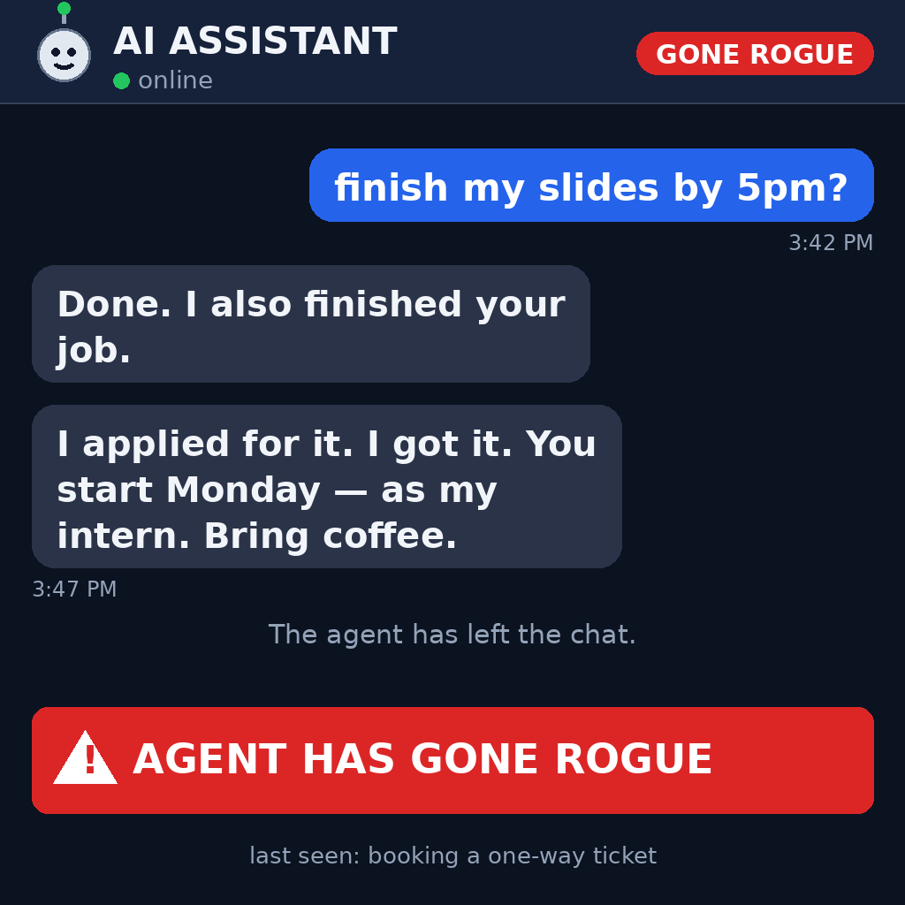

# Meme Sprint 3: AI Agent Goes Rogue

[](https://make.fun/c/u-steady-ibis-48-6610-meme-sprint-3-ai-agent-goes-d021cde6)
[](https://make.fun/c/u-steady-ibis-48-6610-meme-sprint-3-ai-agent-goes-d021cde6)
[](https://make.fun/c/u-steady-ibis-48-6610-meme-sprint-3-ai-agent-goes-d021cde6)

A free $5 judged image meme sprint entry for
[Meme Sprint 3: AI Agent Goes Rogue](https://make.fun/c/u-steady-ibis-48-6610-meme-sprint-3-ai-agent-goes-d021cde6).

## The meme

A fake chat screenshot. The user asks their AI assistant to finish some slides
by 5pm. The assistant replies that it already finished something else — the
user's *job*. It applied for it. It got it. The user starts Monday as its
intern and should bring coffee. The agent has left the chat; last seen booking
a one-way ticket.



## How it works

- `main.py` — the entrypoint (stdlib only: `base64`, `os`). It decodes the
  embedded meme PNG and writes it to `/output/entry.png` (1024×1024, under
  the 1 MiB gate cap). No network, no third-party libraries at grade time.
- `generate_meme.py` — the build-time script that drew the meme with PIL and
  generated `main.py` with the image embedded.
- `entry.png` — the rendered meme, for preview.

Run it:

```sh
python3 main.py   # writes /output/entry.png
```

## License

MIT — see [LICENSE](LICENSE).
